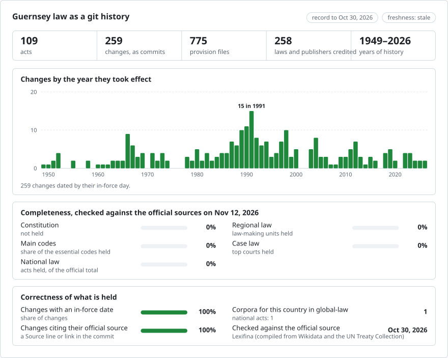

# Guernsey: law history in git

<picture>
<source media="(prefers-color-scheme: dark)" srcset="data/effort-dark.svg">

</picture>

Law of the Bailiwick of Guernsey as a git history: the States' own Laws and Ordinances as laid before them (one file each), and UK legislation for the Bailiwick, with one file per article or schedule, one commit per instrument on the day it came into force, and the instrument as the commit's author. `git blame` names the instrument behind every line; `git log` lists every change to an article; picking a date gives what had come into force by that day, as made.

Part of [lexifina/global-law](https://github.com/lexifina/global-law), one git history for every country's law: this is Guernsey's national law, which global-law reads at `guernsey/national/acts/`.

**What is in it now:** 919 of Guernsey's own Laws, Ordinances and other instruments as laid before the States of Deliberation (239 Laws, 680 Ordinances, 0 other; 2003 to 2026), each the text put to the States, from the Billets d'État on parliament.gg (`billets-d-etat/`); 2 Sark enactments from the Chief Pleas' website (`sark/`); 194 older Laws and Ordinances as FAOLEX holds them, mostly consolidated (`laws/`, `ordinances/`, `statutory-instruments/`; secondary copies); 107 UK Orders in Council and regulations about Guernsey, each in full as made; a catalogue of the 182 UK statutory instruments with "Guernsey" in their title (1949 to 2026); and a snapshot of Guernsey's legal system from Wikidata. [`REPRODUCE.md`](REPRODUCE.md) lists the sources.

Each instrument has its own folder, named from its title and SI number, with one file per article or schedule (`territorial-sea-act-1987-guernsey-order-2019-si-2019-1108/art-002.md` is Article 2 of the Territorial Sea Act 1987 (Guernsey) Order 2019, SI 2019/1108); the catalogue has one file per instrument (`catalogue/si-2019-01108.md`).

The text is in English, as legislation.gov.uk publishes each instrument as made.

## Questions as git commands

| Question | Command |
| --- | --- |
| Every change to Article 2 of the Territorial Sea Order | `git log -p --word-diff -- territorial-sea-act-1987-guernsey-order-2019-si-2019-1108/art-002.md` |
| Which instrument wrote each line of Article 2? | `git blame territorial-sea-act-1987-guernsey-order-2019-si-2019-1108/art-002.md` |
| Every version of the Order, with the day each took effect | `git log --format="%h %(trailers:key=In-force,valueonly,separator=) %an" -- territorial-sea-act-1987-guernsey-order-2019-si-2019-1108/art-002.md` |
| Article 2 as in force on 1 January 2020 | `python tools/on.py 2020-01-01 territorial-sea-act-1987-guernsey-order-2019-si-2019-1108 art-002` |

**Outside git**, we also host this record publicly, for free:

- **[Ask Claude about Guernsey law](https://global-law.lexifina.com/v1/try_claude?country=guernsey)**: opens Claude with a first question ready.
- **[Ask ChatGPT](https://global-law.lexifina.com/v1/try_chatgpt?country=guernsey)**: the same question in ChatGPT.
- **[Search Guernsey law on our site](https://lexifina.com/law?country=guernsey&q=territorial+sea)**: a search for "territorial sea", with each provision's text and its versions, no account needed.
- **[Developer REST API](https://global-law.lexifina.com/v1/search_law?query=territorial+sea&jurisdiction=guernsey)**: the same search as JSON, with no key. See the [documentation here](https://lexifina.com/api/global-law).

Both assistants read the record through the free Global law connector (MCP, `https://global-law.lexifina.com/mcp`); the first time, the chat gives you the link that adds it. Ask in English.

**Host it yourself easily.** All it takes is git and Python, and the tools run on your machine:

```sh
git clone --depth 1 https://github.com/lexifina/global-law && cd global-law
python3 tools/countries.py add guernsey/national/acts
python3 tools/law.py show 2026-01-01 guernsey/national/acts/territorial-sea-act-1987-guernsey-order-2019-si-2019-1108/art-002.md
```

Opened in Claude Code, Cursor, VS Code or Codex, the clone also starts a local MCP server with the same tools ([MCP.md](https://github.com/lexifina/global-law/blob/main/MCP.md)).

## Dates

Each commit is dated at noon, Europe/Guernsey, on the day the version took effect, and carries it in its `In-force:` trailer:

- for each instrument given in full, the single coming-into-force date it states (SI 2019/1108: 23 July 2019); instruments that are revoked, or come into force on another event such as registration by the Royal Court of Guernsey, are catalogued but not given as text;
- for the catalogue, the day each instrument was made, as legislation.gov.uk records it: one commit per day, 151 in all;
- for the Billets d'État records, the fixed day the text says it comes into force on when it gives one, otherwise the day of the States meeting it was laid before (`Date-basis: states-meeting`, which is not a day it came into force); for FAOLEX copies, the date of consolidation, entry into force or text that FAOLEX records (`Date-basis`);
- git cannot store dates before 1970, so the 43 earlier commits are dated from 1970-01-01, one second apart, with the real day in `In-force:`. Ask for a date with `tools/on.py`, not `git log --before`.

Each text is credited to its statutory instrument (`SI 2019/1108`), with an e-mail address that cannot exist; each catalogue day to a key for that day (`Catalogue 2026-09-07`); the catalogue's first day (1949-08-22) and the legal-system snapshot to the publisher, as the oldest version available. The committer is always Lexifina.

## How it is checked

- `tools/check_repo.py` reads every version back from git on the day it took effect and on the day before, and compares it with the corpus: 259 versions of 109 acts, with no mismatch. The results are in [`REPRODUCE.md`](REPRODUCE.md).
- `tools/build.py` writes the history from one corpus file, whose hash is in `data/corpus.sha256`; the same corpus gives the same commit hashes. No second build has been compared yet.
- Every commit's trailers parse, and `main` has no merge commits.
- History is append-only: later changes are appended, never forced.
- [vulnerabilities/](vulnerabilities/): possible drafting mistakes in this law, found by global-law's detectors and checked by hand. Not run yet.

## What it does not show

- **Guernsey's legislation as registered, and its consolidations.** Guernsey Legal Resources, the official publisher, answers automated readers with a Cloudflare challenge, so nothing is read from it. The Billets d'État give each Law and Ordinance as laid before the States, before Royal Sanction or registration; Laws before 2006 and most statutory instruments are only here where FAOLEX holds a copy.
- **Amendments and revocations.** Each instrument is as made, so an Order here may since have been amended or revoked.
- **UK law that does not name Guernsey.** The catalogue lists only instruments with "Guernsey" in their title; UK Acts and instruments that extend to Guernsey without naming it are not listed.
- **75 of the 182 catalogued instruments as text**: those revoked or coming into force on an event rather than a stated date.
- **Footnotes and explanatory notes**, left out of every text; and no court decisions.

## Sources

| Source | Kind | Past versions | Notes |
| --- | --- | --- | --- |
| [legislation.gov.uk](https://www.legislation.gov.uk/uksi) (The National Archives) | UK statutory instruments | no, each as made | Read from the publisher's XML on 30 October 2026 |
| [Wikidata](https://www.wikidata.org/wiki/Q25230) | Open facts | one snapshot, 30 October 2026 | `legal-system/` only |
| [parliament.gg](https://parliament.gg/parliamentary-business/billets) (States of Guernsey) | Laws (Projets de Loi), Ordinances and other instruments as laid before the States of Deliberation, from the Billets d'État and legislation propositions | no, each as laid | PDF text layer, read through the site's public content API in November 2026 |
| [FAOLEX](https://faolex.fao.org) (FAO) | Secondary copies of Guernsey Laws and Ordinances, mostly consolidated | one copy each, dated as FAOLEX records | PDF text layer; `Source-status: secondary copy` |
| [sarkgov.co.uk](https://sarkgov.co.uk) (Chief Pleas of Sark) | Sark Ordinance and consolidated Law, as the Chief Pleas publish them | no, one text each | PDF text layer; the Law is an unofficial in-house consolidation |

## Licence

See [`LICENSE`](LICENSE). The instruments are Crown copyright, reused from legislation.gov.uk under the Open Government Licence v3.0; the facts in `legal-system/` are from Wikidata (CC0 1.0); the Billets d'État texts are States of Guernsey copyright, reproduced from parliament.gg accurately and with their source, as its terms ask; the FAOLEX copies are reused for a non-commercial purpose with acknowledgement of FAO. Lexifina's own contributions (the arrangement of the history, the commit messages, the tables and the tools) are CC0 1.0.

No AI model wrote, translated or changed legal text; the scripts were written by an AI model (see [`REPRODUCE.md`](REPRODUCE.md)).

## Visualisations

- [visualisations/](visualisations/): charts drawn from this repository. Not drawn yet.

## More

From [lexifina/global-law](https://github.com/lexifina/global-law):

- [FEATURES.md](https://github.com/lexifina/global-law/blob/main/FEATURES.md): every feature, and what every corpus must support (`git blame`, `law.py`, the MCP tools)
- [FAQ.md](https://github.com/lexifina/global-law/blob/main/FAQ.md): questions and answers · [CONTRIBUTING.md](https://github.com/lexifina/global-law/blob/main/CONTRIBUTING.md): proposing changes · [MCP.md](https://github.com/lexifina/global-law/blob/main/MCP.md): the MCP server · [REPRODUCE.md](https://github.com/lexifina/global-law/blob/main/REPRODUCE.md): how it was built · [CHANGELOG.md](https://github.com/lexifina/global-law/blob/main/CHANGELOG.md)
- [FRESHNESS.md](https://github.com/lexifina/global-law/blob/main/FRESHNESS.md): how current each corpus is · [Monitoring](https://github.com/lexifina/global-law/tree/main/monitoring): whether updates are running · [WATCHING.md](https://github.com/lexifina/global-law/blob/main/WATCHING.md): how each official source is watched for changes
- [performance/](https://github.com/lexifina/global-law/tree/main/performance): how fast the tools are, measured
- [visualisations/](https://github.com/lexifina/global-law/tree/main/visualisations): charts and bridges across the world's law
- [Vulnerabilities](https://github.com/lexifina/global-law/tree/main/vulnerabilities): mistakes in legislation as published
